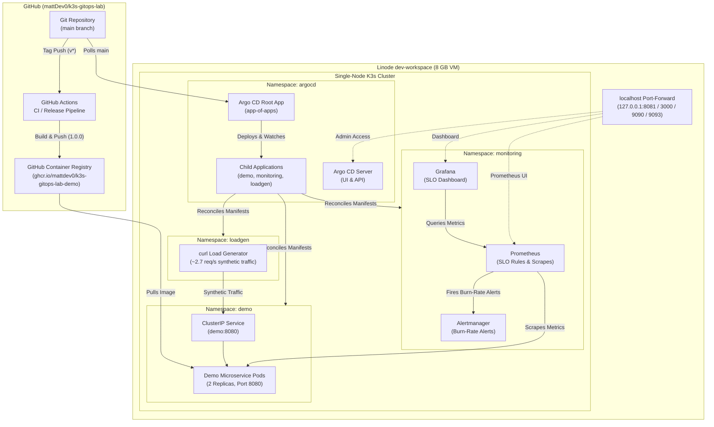

# k3s-gitops-lab

A single-node Kubernetes lab running on an 8 GB Linode VM (`dev-workspace`), built to learn and demonstrate GitOps workflows, automated release verification, Prometheus SLO burn-rate alerting, and a git-driven rollback. The service is a small Rust application deployed exclusively through Argo CD with automated drift correction, without public exposure or production traffic claims. I created the VM and its firewall by hand; `infra/terraform/` describes them with import blocks. The cluster runs until the VM's Linode credit ends on 2027-01-01, and after that this repository is the record of the project.

---

## Architecture



---

## What This Demonstrates

- **GitOps with drift correction**: All cluster resources are managed declaratively through an Argo CD app-of-apps architecture with automated pruning (`prune: true`) and self-healing (`selfHeal: true`). Live state is kept in continuous alignment with `main`.
- **Pinned and scanned releases**: Semantic version tags trigger immutable container builds on `rust:1.99.1-slim-bookworm` published to `ghcr.io`, packaged in a minimal Google Distroless runtime image (`gcr.io/distroless/cc-debian12:nonroot`) pinned by sha256 digest, and scanned with Trivy in CI and again before every release push.
- **SLO with burn-rate alerts and tested rules**: A synthetic 99.0% availability Service Level Objective implemented with multi-window multi-burn-rate alerting ($14.4\times$ page and $6.0\times$ ticket alerts). Recording rules are tested in CI using `promtool test rules` against synthetic failure and baseline timeseries fixtures.
- **Rollback by git revert with measured recovery**: Controlled fault injection (`FAULT_ERROR_RATE: "0.3"`) triggering alert transitions, followed by a `git revert` merged through a PR. Argo CD deployed it on its own and errors stopped 3 minutes 18 seconds after the merge; the page alert fired 29.5 minutes after the first error, and the write-up explains why. Documented in the [bad release incident report](docs/incidents/2026-11-05-bad-release-rollback.md).

---

## Documentation

- [Architecture & Design Decisions](docs/architecture.md) — Cluster bootstrap steps, design choices, and networking rationale.
- [Service Level Objective & Burn-Rate Alerting](docs/slo.md) — SLO specification, multi-window mathematics, recording rules, and operational runbooks.
- [Pinned Versions](docs/versions.md) — Exhaustive inventory of toolchains, container digests, Helm charts, and action versions.
- [Incident Report: Bad Release Rollback](docs/incidents/2026-11-05-bad-release-rollback.md) — Complete timeline, metrics, PromQL queries, and visual evidence from the fault-injection exercise.
- [Cluster Teardown Runbook](docs/teardown.md) — Step-by-step decommissioning procedure for Matt to run before Linode credits expire.

---

## Infrastructure as Code (Terraform)

The VM (`dev-workspace`, ID: `109711421`) and Cloud Firewall (`dev-workspace-fw`, ID: `229456920`) were created by hand and are formally described in `infra/terraform/` using Terraform `import` blocks. 

```
infra/terraform/
├── .gitignore
├── .terraform.lock.hcl
├── main.tf
└── versions.tf
```

The VM itself holds no Linode API token. The import plan is run read-only from my workstation, with the token only in the environment (`plan` never changes anything, and both resources have `prevent_destroy`):

```bash
cd infra/terraform
export LINODE_TOKEN=...   # never committed; state and tfvars are git-ignored
terraform init
terraform plan
```

Both `terraform fmt -check` and `terraform validate` are executed in CI on every push and pull request.

---

## How It's Run

### 1. Local Development
Run the Axum demo service with Cargo:

```bash
cd app
cargo run
```

Endpoints:
- `GET /` — Service metadata (`{"service":"demo","version":"1.0.0"}`)
- `GET /healthz` — Liveness probe (200 OK)
- `GET /readyz` — Readiness probe (200 OK)
- `GET /metrics` — Prometheus metrics format (`http_requests_total`, `http_request_duration_seconds`)

Fault injection can be configured via environment variables:
```bash
# Injects a 30% failure rate (HTTP 500) on GET /
FAULT_ERROR_RATE=0.3 cargo run
```

### 2. Container Packaging
Build and run the container locally:

```bash
docker build -t demo:local app/
docker run --rm -p 8080:8080 demo:local
```

### 3. Cluster Access
The cluster runs privately without public ingresses. Connect via localhost port-forwards over SSH or Tailscale:

```bash
# Argo CD UI (https://localhost:8081)
kubectl -n argocd port-forward svc/argocd-server 8081:443

# Grafana Dashboard (http://localhost:3000)
kubectl -n monitoring port-forward svc/monitoring-grafana 3000:80

# Prometheus UI (http://localhost:9090)
kubectl -n monitoring port-forward svc/monitoring-kube-prometheus-prometheus 9090:9090

# Alertmanager UI (http://localhost:9093)
kubectl -n monitoring port-forward svc/monitoring-kube-prometheus-alertmanager 9093:9093
```

---

## Teardown

The cluster runs until the VM's Linode credit ends on 2027-01-01. Before then I tear it down by hand with the [teardown runbook](docs/teardown.md); after that, this repository is the record of the project.
