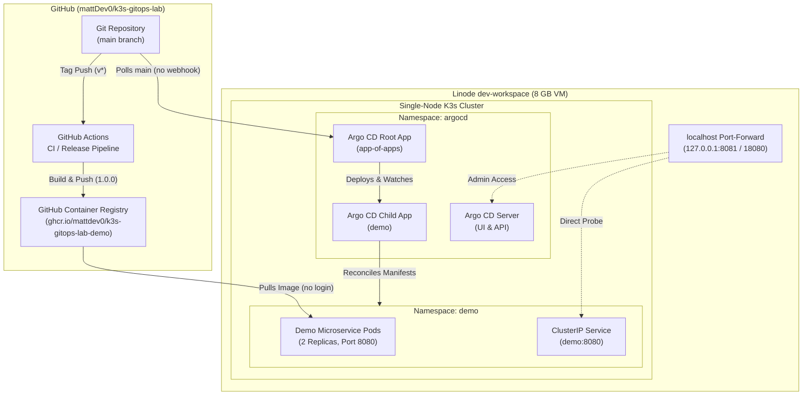

# Architecture & Design Decisions

This document details the architecture of the `k3s-gitops-lab` single-node environment, illustrating how code flows from git to cluster deployment and recording key architectural design decisions.

## System Architecture

## Bootstrap (the only manual steps)

Everything in the cluster arrives through Argo CD from `main`, except these one-time steps:

1. Install K3s `v1.37.2+k3s1` with `--disable traefik --disable servicelb --write-kubeconfig-mode 600`, after reading the install script.
2. Install Argo CD `v3.6.1` from its pinned `install.yaml`. I used `kubectl apply --server-side --force-conflicts`, because the `applicationsets.argoproj.io` CRD is larger than the 256 KB limit of the annotation that a client-side apply writes.
3. Scale `argocd-dex-server` to 0 replicas (SSO is not needed; the built-in admin account is enough for a single-user lab).
4. `kubectl apply -f deploy/argocd/root.yaml`. The root Application then creates the `lab` AppProject (sync wave -1) and the `demo` Application from `deploy/argocd/apps/`.

## Resource footprint after Stage 2

Measured on 2026-11-04 with K3s, Argo CD and two demo pods running:

- `kubectl top nodes`: 249m CPU (6%), 2812Mi memory (35%)
- `free -m`: 1995 MiB used of 7941 MiB total, 5945 MiB available

---

## Design Decisions

### 1. Why Argo CD
I selected Argo CD as the GitOps delivery engine because it operates entirely within the cluster, polling Git for the desired state and comparing it continuously against live cluster state. It provides built-in automated sync, self-healing (`selfHeal: true`), prune capabilities (`prune: true`), and clear drift visibility without requiring cluster credentials to leave the machine.

### 2. Why Traefik and ServiceLB are Disabled
The Linode host runs a strictly private network model:
- Tailscale serves private tooling (such as code-server) terminating TLS on port 443 on the tailnet interface.
- By default K3s installs Traefik with a LoadBalancer Service, and ServiceLB (Klipper) publishes it on the host's ports 80 and 443.
- Disabling both via `--disable traefik --disable servicelb` keeps 80 and 443 free, so nothing in the cluster competes with Tailscale for 443. The Argo CD UI and the demo service are reached only through `kubectl port-forward` bound to `127.0.0.1`.
- K3s itself still listens on all interfaces for the API server (6443) and the kubelet (10250). They are not reachable from the internet because the Linode Cloud Firewall drops all inbound traffic; SSH and everything else go over Tailscale.

### 3. Why Image Tags Only Change via Pull Requests
Automated tools that write image tag bumps directly back to Git repositories blur the boundary between build artifacts and production deployment intent. By requiring container image tags to be pinned explicitly in `deploy/apps/demo/deployment.yaml` and updated only through PRs:
- Every deployment change produces a clear, auditable Git commit with a distinct author and commit message.
- Reverting a deployment (demonstrated in Stage 4) is a straightforward `git revert`.
- Continuous Delivery cannot accidentally deploy untested tags to the cluster.

### 4. The `lab` project's cluster-wide permissions
kube-prometheus-stack needs cluster-scoped objects, so the `lab` AppProject allows Namespaces, ClusterRoles, ClusterRoleBindings, CRDs and admission webhooks. In practice, anyone who can merge to `main` has close to cluster-admin. That is acceptable for a single-user lab; a shared cluster would split monitoring into its own project with a narrower allow-list.

### 5. What Is Deliberately Left Out
- **Public Ingress & DNS/TLS**: The lab does not serve public traffic or require Let's Encrypt certificates. It is an internal demonstration environment accessed securely over localhost port-forwards.
- **High Availability (HA) & Multi-Node**: The entire platform runs on a single Linode standard instance with 8 GB RAM and 4 vCPUs. Clustering overhead (etcd quorum, redundant control planes) is unnecessary for the scope of this learning lab and would consume valuable memory needed by Prometheus and Argo CD.
