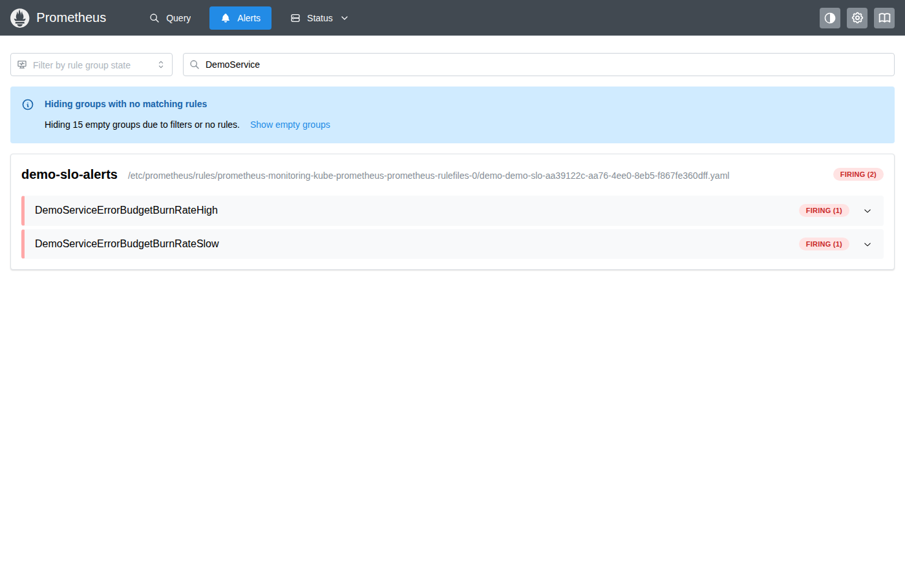
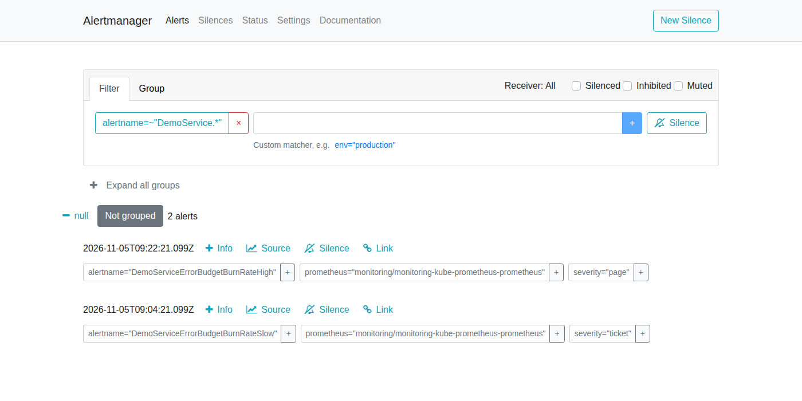
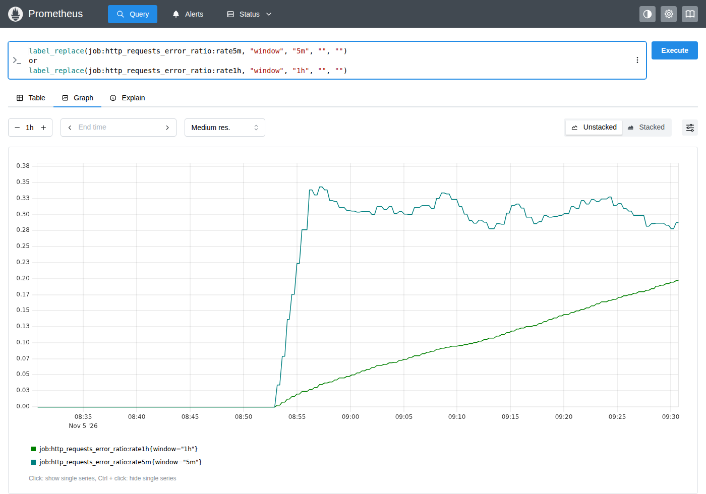
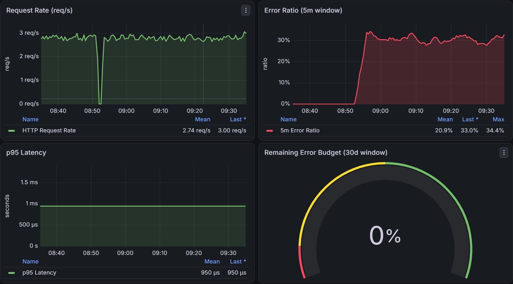

# Bad release returned 500s on 30% of requests, rolled back through git

| | |
|---|---|
| Date | 2026-11-05 |
| Severity | Low (planned fault-injection exercise in a single-node lab; synthetic traffic only, no users) |
| Status | Resolved |
| Bad release | [PR #7](https://github.com/mattDev0/k3s-gitops-lab/pull/7) (`7916067`) |
| Fix | [PR #8](https://github.com/mattDev0/k3s-gitops-lab/pull/8), a `git revert` of PR #7 (`38c6642`) |

## Summary
This was a planned exercise, not a real outage: I shipped a deliberately bad release to my K3s lab to check that the SLO alerts catch it and that a rollback through git works. The release set `FAULT_ERROR_RATE` to `0.3`, so the demo service returned HTTP 500 on about 30% of `GET /` requests. Argo CD deployed it automatically. The ticket-level burn-rate alert fired after 11.5 minutes and the page-level alert after 29.5 minutes. I rolled back by merging a `git revert` of the release; Argo CD deployed the revert on its own and errors stopped 3 minutes 18 seconds after the merge. Alerts went to Alertmanager's default receiver only: real notification delivery is deliberately left out of this lab.

## Impact
- **Users:** none. All traffic came from the in-cluster `loadgen` Deployment at a measured 2.71 requests/s (`sum(rate(http_requests_total{route="/",method="GET"}[1h]))`).
- **Errors:** 2,516 of 8,157 `GET /` requests failed between the first error and the rollback, 30.8%, matching the injected rate (`increase(...[49m])` evaluated at 09:41:30Z).
- **Error budget:** about **3.6%** of the 30-day budget. At 2.71 requests/s, 30 days is about 7.04 million requests, so the 1% budget is about 70,400 errors, and 2,518 errors (`sum(increase(http_requests_total{route="/",method="GET",status=~"5.."}[3h]))`) is 3.58% of it.
- The Grafana gauge showed 0% budget left. That overstates the damage: its 30-day `increase()` only had about 2.5 hours of data, because the lab was built that morning.

## Timeline (UTC)

| Time | Event |
|---|---|
| 08:10 | Synthetic traffic starts (the loadgen arrived with the monitoring stage). |
| 08:50:34 | PR #7 merged: `FAULT_ERROR_RATE: "0.3"`, same `1.0.0` image. |
| 08:50:59–08:51:00 | Argo CD syncs `demo` to `7916067` without any manual refresh; the rolling update starts. |
| 08:51:15–~08:52:30 | No pod serves any `GET /` request. The new pods are up and scraped from 08:51:15, but their request counters don't move until about 08:52:30 (see What I learned). |
| 08:52:51 | First HTTP 500. |
| 08:54:32 | 5-minute error ratio passes 14.4% (0.176). |
| 09:02:21 | Ticket alert (`DemoServiceErrorBudgetBurnRateSlow`) pending: 6h and 30m ratios both above 6%. |
| 09:04:21 | **Ticket alert firing.** |
| 09:20:21 | Page alert (`DemoServiceErrorBudgetBurnRateHigh`) pending: the 1h ratio reaches 0.1477, above 0.144. |
| 09:22:21 | **Page alert firing.** |
| 09:26:19 | PR #8 opened: `git revert -m 1 7916067`, no hand edits. |
| 09:30–09:35 | Screenshots taken while both alerts were firing. |
| 09:37:52 | PR #8 merged (`38c6642`). |
| 09:41:01–09:41:02 | Argo CD syncs the revert on its own, 3 minutes 10 seconds after the merge. |
| 09:41:10 | Pods with `FAULT_ERROR_RATE: "0.0"` serving; no more 500s. |
| 09:44:51 | **Page alert resolved**: the 5m ratio dropped below 14.4% (0.122 at 09:44:32). |
| 09:46:10 | 5-minute error ratio back to 0. |
| ~10:06:20 | **Ticket alert resolved** (last firing sample at 10:06:15 in a 15-second `query_range` of `ALERTS`). |

**Measured:** time to detect 29 minutes 30 seconds (first error to page) and 11 minutes 30 seconds to the ticket alert. From the page firing to errors stopping took 18 minutes 49 seconds; most of that was me deciding to roll back and taking screenshots. From the revert merge to errors stopping took 3 minutes 18 seconds.

## Root cause
PR #7 changed one line in `deploy/apps/demo/deployment.yaml`:

```yaml
- name: FAULT_ERROR_RATE
  value: "0.3"
```

The demo service reads this variable at startup and fails that share of `GET /` requests with a 500. The change was deliberate. As a "release" it passed CI, because CI checks that the manifests are valid, not what the configuration does at runtime.

## Fix
A revert through a pull request, with no `kubectl` changes to the cluster:

```bash
git switch -c fix/revert-1.1.0 origin/main
git revert -m 1 7916067
git push -u origin fix/revert-1.1.0
gh pr create --title "revert: roll back release 1.1.0"
```

After the merge, Argo CD picked up `38c6642` on its normal polling and rolled the Deployment back.

## Verification
- `kubectl get application demo -n argocd -o yaml`: sync revision `38c66427ff681f4d0c9e55fc9057019231833dbd`, phase `Succeeded`.
- Pod environment after the rollback: `[{"name":"FAULT_ERROR_RATE","value":"0.0"},{"name":"PORT","value":"8080"}]`.
- `job:http_requests_error_ratio:rate5m` returned 0 at 09:46:27Z.
- Both alerts inactive in `/api/v1/rules`, and their `ALERTS` series ended (page after 09:44:45, ticket after 10:06:15).

## Evidence
Both alerts firing in Prometheus:



Alertmanager with the start times (ticket 09:04:21Z, page 09:22:21Z):



The 5-minute ratio jumps to about 30% within minutes, while the 1-hour ratio climbs slowly past 14.4%:



The Grafana dashboard during the fault:



## What I learned
- **The page alert is slow from a clean baseline.** With 30% errors, the 1-hour ratio needed about 27 minutes to pass 14.4%, plus the 2-minute `for:`, so the page took 29.5 minutes. The 5-minute ratio passed the threshold within 2 minutes. That is the trade-off of the long window: it filters out short spikes but delays detection of a sudden failure.
- **The short window makes the page clear fast.** The page alert resolved 3 minutes 41 seconds after healthy pods were serving, even though the 1-hour ratio was still high, because the alert needs both windows above the threshold.
- **The ticket alert fired first only because the lab was new.** Traffic had started about 40 minutes before the fault, so the "6-hour" window held 40 minutes of data and its ratio rose almost as fast as the 30-minute one. With hours of history, the page would normally come first.
- **The SLI can't see requests that never reach a pod.** During the rollout, no requests were served for about 75 seconds, and none of them show up as errors, because `http_requests_total` is counted by the service itself. My likely explanation is that the loadgen's `curl` has no timeout, so a request to a terminating pod hung instead of failing; I haven't confirmed this.
- **Grafana got a new admin password and restarted on every merge to `main`.** The chart generates a random password when it renders, Argo CD renders it again for every new commit, and Grafana's ReplicaSets were recreated right after each merge that day. My saved login stopped working halfway through this exercise.

## Open items
- Give Grafana a fixed admin password via `grafana.admin.existingSecret`, pointing at a Secret created once by hand and kept out of git, so merges stop restarting Grafana.
- Add `--max-time` to the loadgen's `curl`, then repeat a rollout to check whether the 75-second gap goes away. Consider a client-side or probe-based SLI, so that requests that never reach a pod count too.
- Consider a faster page condition for sudden total failures, for example a higher burn rate over shorter windows, and test it with `promtool` first.
